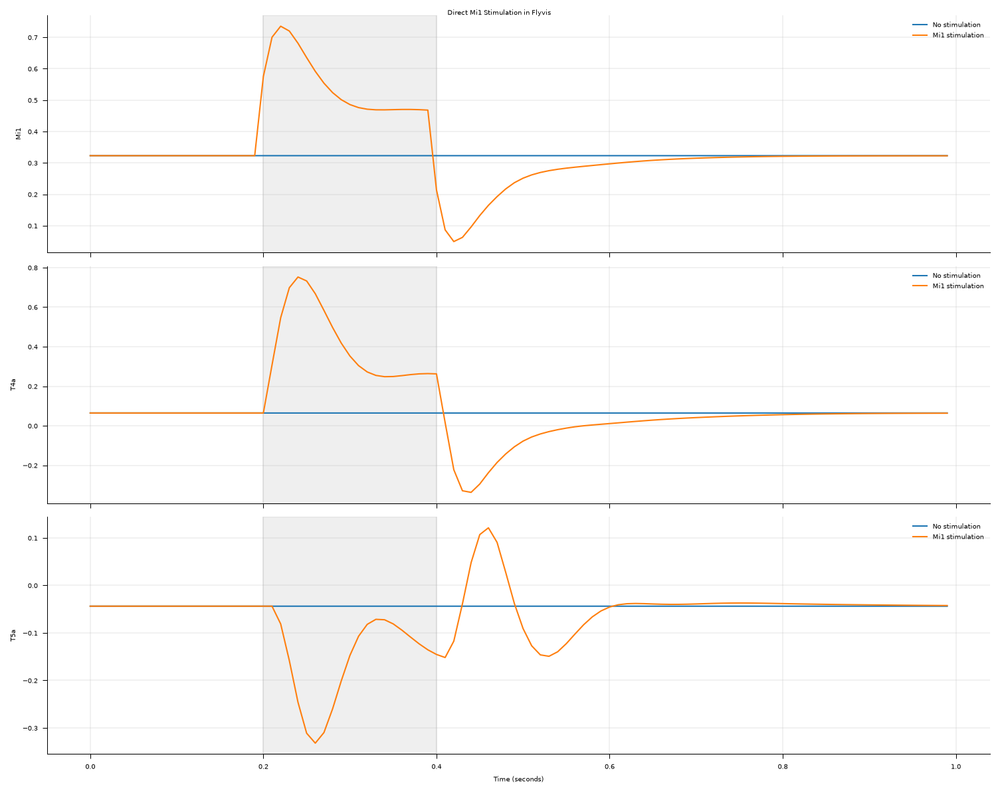
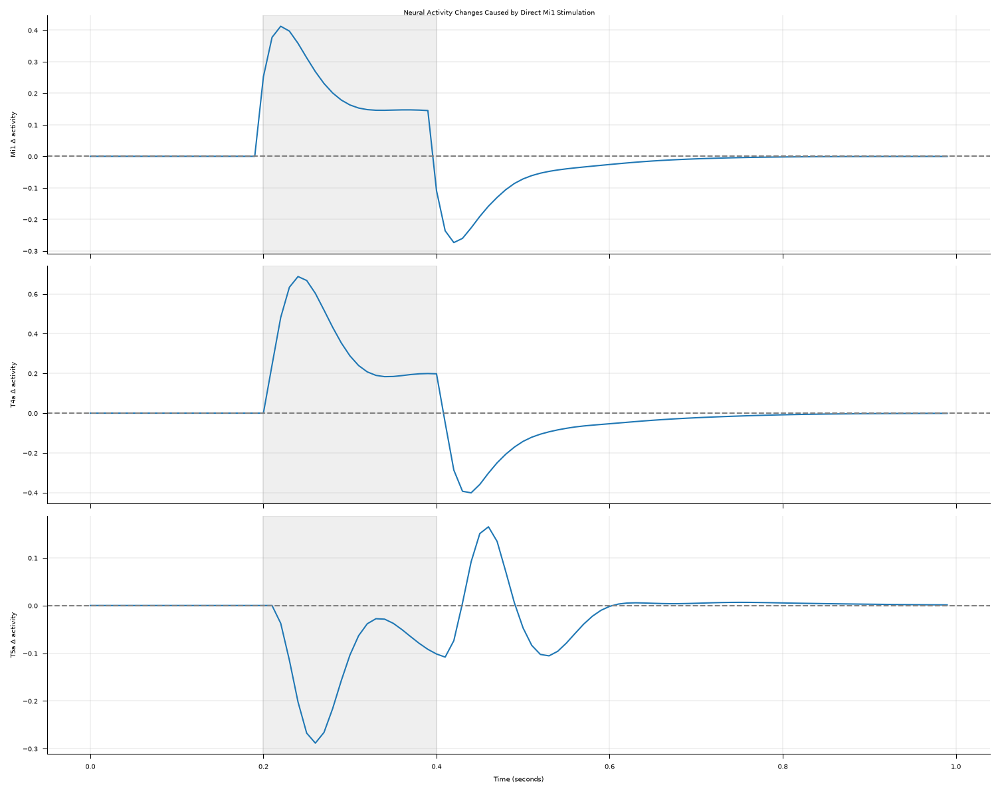
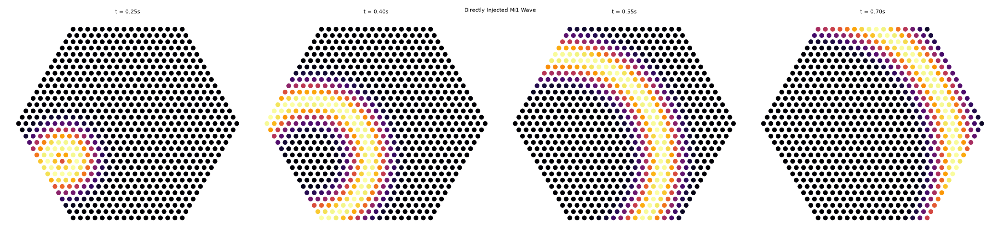
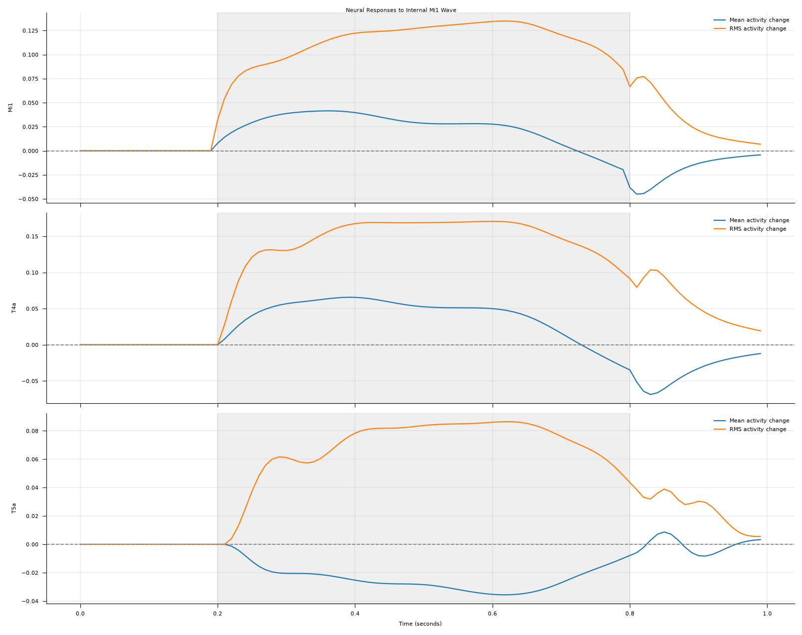

# Retinal-Wave-Inspired Stimuli in Flyvis

**A mini-project exploring how propagating activity patterns influence a connectome-constrained visual system model.**

## Overview

Retinal waves are spontaneous, spatially and temporally correlated patterns of neural activity observed in the developing retina. They are thought to contribute to the organization and maturation of visual circuits before normal visual experience.

This project explores a simplified question:

**How does a pretrained visual neural network respond to propagating wave-like activity compared with conventional motion stimuli and random noise?**

To investigate this, synthetic retinal-wave-inspired stimuli were generated and presented to **Flyvis**, a connectome-constrained model of the *Drosophila* (fruit fly) visual system.

The project is an exploratory proof of concept, rather than a biologically detailed simulation of retinal development.

## Experimental Pipeline

1. Generate synthetic spatiotemporal stimuli on a 64 × 64 grid.
2. Normalize stimulus movies to comparable global luminance and contrast statistics.
3. Project the movies onto Flyvis' hexagonal visual lattice using `BoxEye`.
4. Simulate responses using a pretrained Flyvis network.
5. Extract and compare temporal responses from selected cell types.

## Stimuli

Three stimulus conditions were implemented:

- **Retinal-wave-inspired stimulus:** a Gaussian ring expanding outward from a fixed origin
- **Moving bar:** a bright vertical bar translating horizontally across the visual field
- **Random noise:** spatially and temporally uncorrelated Gaussian noise

All stimuli contain **60 frames** and are simulated with a time step of **10 ms**.

### Retinal-wave-inspired stimulus animation

The main stimulus used in this project is an expanding wavefront.  
The animation below shows the synthetic retinal-wave-inspired stimulus before projection into Flyvis.


### Stimulus overview

The figure below compares representative frames from all three stimulus conditions after global normalization.


The retinal wave contains a propagating expanding structure, the moving bar provides a conventional motion stimulus, and the random-noise condition serves as an unstructured control.

## Flyvis Model

The experiments use the pretrained `flow/0000/000` network from [Flyvis](https://github.com/TuragaLab/flyvis).

The network is based on the connectivity of the fruit fly visual system and contains approximately 45,669 modeled neurons across 65 cell types.

The visual input is projected onto 721 hexagonal sampling positions.

**Input dimensions:** `(1, 60, 1, 721)`

**Neural response dimensions:** `(1, 60, 45669)`

No additional network training or fine-tuning was performed.

## Preliminary Results

### 1. Response to the retinal-wave-inspired stimulus

The first analysis examines how selected Flyvis cell types respond to the synthetic retinal wave alone.


Responses were examined for five representative cell types:

- `R1`: photoreceptor
- `L1`: lamina neuron
- `Mi1`: medulla neuron
- `T4a`: motion-processing pathway
- `T5a`: motion-processing pathway

These cell types exhibit distinct temporal response profiles, indicating that the propagating wavefront drives structured activity throughout multiple stages of the Flyvis visual pathway.

### 2. Comparison with control stimuli

The next analysis compares responses across the three stimulus classes: retinal wave, moving bar, and random noise.  
Before comparison, the stimulus movies were normalized to comparable global mean luminance and standard deviation.


Several qualitative observations can be made from this figure:

- The **retinal wave** produces clear time-varying responses across all selected cell types.
- The **moving bar** often produces partially similar dynamics, especially in later visual pathways such as `T5a`.
- The **random-noise** condition generally remains closer to baseline in the spatially averaged responses shown here.

These results suggest that the pretrained Flyvis model responds differently to structured propagating input than to uncorrelated noise.  
They also suggest that the retinal-wave-inspired stimulus shares some dynamic properties with conventional motion stimuli, while still producing distinct temporal response patterns.

### 3. Whole-network average response

For completeness, the average activity across all modeled neurons was also examined for the retinal-wave-inspired stimulus.


This plot serves mainly as a sanity check showing that the stimulus drives non-trivial temporal dynamics in the network.  
Because it averages across all neurons, it is less informative than the cell-type-specific plots above.

## Installation

The project was developed under Ubuntu on WSL2 using Python 3.11.

Create a Conda environment:

```bash
conda create -n retinal-waves python=3.11 -y
conda activate retinal-waves
```

Install dependencies:

```bash
pip install flyvis numpy torch matplotlib pillow
```

Download the pretrained networks:

```bash
flyvis download-pretrained
```

## Reproducing the Experiments

Generate the wave animation:

```bash
python wave_generator.py
```

Run the pretrained network simulation:

```bash
python run_wave_through_flyvis.py
```

Plot individual cell-type responses:

```bash
python plot_cell_type_responses.py
```

Compare the three stimulus conditions:

```bash
python compare_stimuli_responses.py
```

Generate the stimulus overview figure:

```bash
python plot_stimuli.py
```

Outputs are saved in the `results/` directory.


## Experiment 2: Direct Internal Neural Stimulation

### Objective

Our initial experiments presented synthetic retinal-wave-inspired images through Flyvis' photoreceptor pathway.

In this second experiment, we investigate whether **direct stimulation of internal neurons can influence downstream visual processing without presenting visual input**.

This is motivated by the broader hypothesis that structured spontaneous neural activity may influence visual circuit development before normal visual experience.

We investigate two stimulation conditions:

1. **Uniform stimulation:** Simultaneously activate all Mi1 neurons for a short interval.
2. **Propagating-wave stimulation:** Apply a spatially expanding Gaussian wave to Mi1 neurons.

Both conditions are compared against an unstimulated control using a pretrained Flyvis network.

### Experimental Setup

| Parameter | Value |
|---|---|
| Model | `flow/0000/000` |
| Model status | Pretrained; weights frozen |
| Total modeled neurons | 45,669 |
| Target population | Mi1 |
| Stimulated Mi1 neurons | 721 |
| Integration time step | 10 ms |
| Observation duration | 1 second |
| Initial-state preparation | 2 seconds of zero external stimulation |
| Photoreceptor input | Zero external stimulation |
| Monitored populations | Mi1, T4a, T5a |

Both the stimulated and control conditions start from the same initial network state.

**Important:** These experiments test neural responses, not learning. No model parameters are updated.

### Experiment 2.1: Uniform Mi1 Stimulation

All 721 Mi1 neurons receive a stimulation amplitude of `0.5` between 0.2 and 0.4 seconds.

The unstimulated control receives zero external input throughout the simulation.

#### Neural activity responses



The figure compares average neural activity with and without stimulation.

We observe that:

- Mi1 activity rises immediately after stimulation begins.
- T4a responds strongly despite receiving no direct external stimulation.
- T5a also responds, exhibiting different temporal dynamics.
- Activity gradually returns toward its unstimulated baseline after the input is removed.

These observations indicate that direct Mi1 stimulation influences other populations through the model's internal dynamics.

#### Stimulation-induced activity changes



To isolate the effect of stimulation, we subtract control activity from stimulated activity:

$$
\Delta A(t) = A_{\text{stimulated}}(t) - A_{\text{control}}(t)
$$

Maximum absolute changes in spatially averaged activity:

| Cell type | Maximum absolute activity change |
|---|---:|
| Mi1 | 0.4124 |
| T4a | 0.6879 |
| T5a | 0.2883 |

T4a exhibits the largest absolute change among the three measured populations.

However, activity magnitudes are not necessarily directly comparable across cell types because their response scales may differ.

### Experiment 2.2: Propagating Internal Mi1 Wave

Instead of activating all Mi1 neurons simultaneously, we generate an expanding Gaussian wave directly on the hexagonal Mi1 lattice.

The stimulation is defined by:

$$
S_i(t) = A \exp\left(-\frac{(d_i-r(t))^2}{2\sigma^2}\right)
$$

where:

- \(A=0.5\) is the maximum stimulation amplitude.
- \(d_i\) is the spatial distance of neuron \(i\) from the wave origin.
- \(r(t)\) is the expanding wave radius.
- \(\sigma=1.8\) controls the wavefront width.

Stimulation begins at 0.2 seconds and continues until 0.8 seconds.

#### Spatial wave propagation



Each point represents one Mi1 neuron at its hexagonal lattice position.

The color indicates the amplitude of externally injected stimulation, rather than the neuron's resulting activity.

Unlike the original image-based experiment, **the wave is injected directly into Mi1 neurons without using `BoxEye` or supplying visual input through photoreceptors**.

#### Downstream neural responses



We evaluate two measurements:

**Mean activity change**

The average difference between stimulated and control activity across the selected cell population.

**RMS activity change**

The root mean square of the differences across neurons:

$$
\mathrm{RMS}(t) =
\sqrt{\frac{1}{N}\sum_{i=1}^{N}
\left(A_i^{\text{stimulated}}(t)-A_i^{\text{control}}(t)\right)^2}
$$

Unlike a signed mean, RMS captures response magnitudes without cancellation between positive and negative activity changes.

The results show:

- **Mi1:** Clear responses during the injected wave, with sustained activity differences across the stimulation interval.
- **T4a:** A substantial downstream response, even though T4a neurons were not directly stimulated.
- **T5a:** A smaller but distinct response, including negative mean activity changes for much of the stimulation interval.
- **Post-stimulation:** Activity differences decay after stimulation ends, indicating continued transient network dynamics.

These findings demonstrate that structured external stimulation of an internal neural population can produce distributed responses in the pretrained Flyvis model.

### Interpretation

The two experiments establish that:

1. Direct external stimulation can be applied to selected internal Flyvis neurons.
2. Photoreceptor input can remain zero while the internal circuitry responds to injected activity.
3. Stimulating Mi1 influences other neural populations, including motion-related T4a and T5a cells.
4. Spatially structured wave stimulation produces measurable temporal changes across multiple cell types.

This provides a practical foundation for investigating whether spontaneous wave-like activity can serve as a pretraining signal before visual experience.

However, **these findings do not demonstrate learning, developmental organization, or improved optical-flow performance**. Those questions require training networks from scratch and comparing their subsequent visual behavior.
